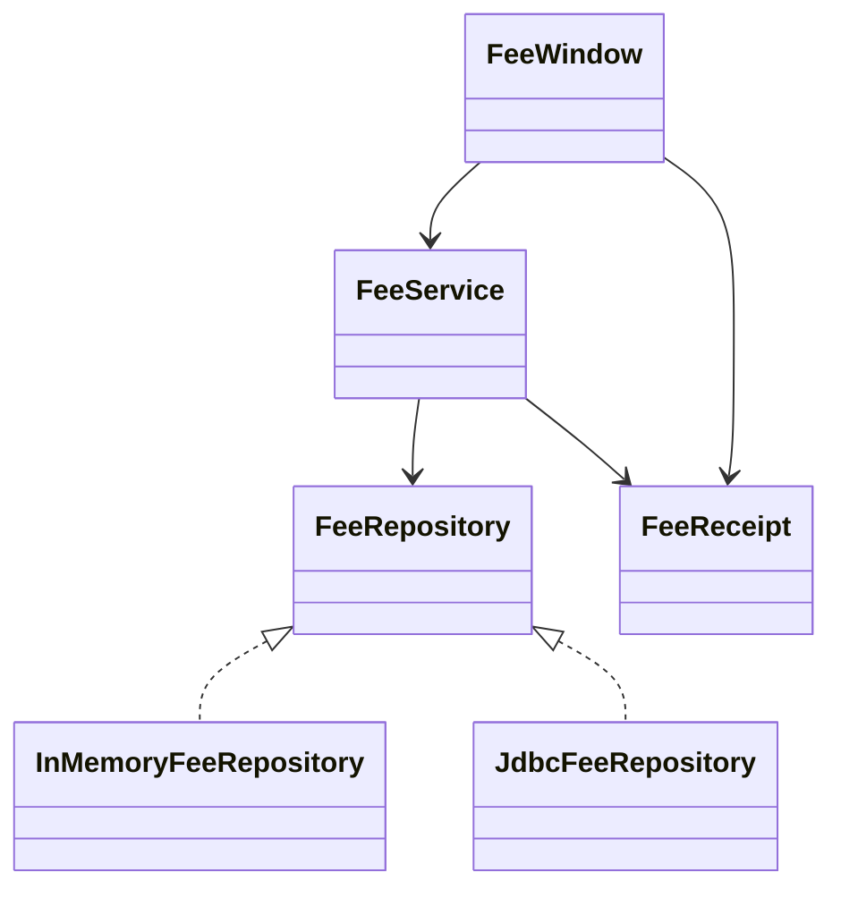

# Task 1 — FeeWindow review

## 1.1 Defects and user-visible effects

| Defect | User-visible effect |
|---|---|
| One listener handles unrelated buttons | A button can trigger the wrong operation when branching is incomplete. |
| Action commands compared with `==` | String identity may not match the command value; the click is ignored or misrouted. |
| No input validation | Blank IDs, malformed amounts, or non-positive payments reach later code and fail unpredictably. |
| JDBC and `sleep(3000)` run on the EDT | The window stops repainting and responding while the operation runs. |
| SQL built by concatenating input | Quotes or crafted input can corrupt the query or alter its meaning. |
| Receipt action falls into the `else` branch | Choosing Receipt performs the fallback action instead of showing the receipt. |
| Exceptions are unhandled | The operation fails without a useful message; the application may print a stack trace or stop. |
| No window-closing handler | Close-time cleanup or confirmation is skipped; resources may remain open. |
| Database connection is never closed | Connections leak and later operations may fail after the pool is exhausted. |

## 1.2 Redesign

- `FeeWindow` owns widgets and event handling; each button has its own listener.
- `FeeService` validates student ID and amount before calling a repository.
- `JdbcFeeRepository` uses `PreparedStatement` parameters and try-with-resources.
- `InMemoryFeeRepository` is used by default, so the UI runs without a database.
- Payment and receipt lookup use `SwingWorker`; errors are surfaced in dialogs.
- A `WindowAdapter` handles the close event.

## 1.3 Defence

Separating the UI, service, and repository keeps database details out of the window and makes the payment rules testable. The service validates before saving, while parameterized SQL prevents user input from becoming SQL syntax. The in-memory repository provides a runnable default without external setup. `SwingWorker` keeps both payment and receipt lookup off the event-dispatch thread, and try-with-resources closes JDBC resources reliably.

## Alternative: one if-else listener vs one listener per button

The chain checks commands sequentially, so dispatch is O(k) in the worst case; direct listener selection is O(1). The benchmark used `System.nanoTime()`, one warm-up and five measured runs per size, randomized action indices with a fixed seed, and the median ns/dispatch. Results are indicative microbenchmark measurements on OpenJDK 25.0.4.1; JIT and hardware affect absolute timings.

| Buttons k | If-else chain (ns/dispatch) | Per-button listener (ns/dispatch) |
|---:|---:|---:|
| 10 | 20.61 | 4.39 |
| 1,000 | 231.05 | 0.65 |
| 10,000 | 1,618.15 | 0.35 |

Dispatch-only space: O(1) extra for the chain and O(k) listener references for per-button registration. Benchmark source: `source/DispatchBenchmark.java`; raw output: `output.txt`.
