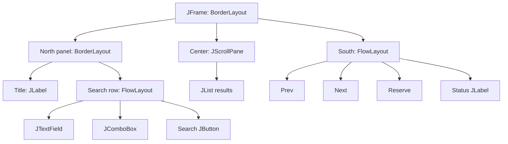

# Task 3 — Library search screen

## 3.1 Layout by container

| Container | Layout and contents | Why it resizes well |
|---|---|---|
| `JFrame` | `BorderLayout` | The results area receives remaining space. |
| North panel | `BorderLayout`: title north, search row south | Keeps the title and controls grouped at the top. |
| Search row | `FlowLayout`: text field, `JComboBox` (Swing Choice), Search | Controls keep preferred sizes and wrap/reflow with the row. |
| Center | `JScrollPane` containing `JList` results | Scrolls when results exceed the available height; expands with the frame. |
| South | `FlowLayout`: Prev, Next, Reserve, status | Controls stay together at their preferred size. |

## 3.2 Nested-panel diagram



## 3.3 Implementation

`source/LibrarySearch.java` includes title/author/both filtering, Enter-to-search, paged results, reserve feedback, and enabled/disabled Prev/Next controls.

## 3.4 Resize behavior

| Window size | Expected behavior | Screenshot placeholder |
|---|---|---|
| 800 x 600 | Search controls and footer retain preferred sizes; center list uses remaining space. | `library-800x600.png` |
| 1024 x 768 | More result rows are visible; scroll pane remains the expanding region. | `library-1024x768.png` |
| 1440 x 900 | Center region grows; top and bottom controls remain grouped and readable. | `library-1440x900.png` |

## Alternative: GridBagLayout vs null layout

```java
// GridBagLayout: constraints can share extra space and reposition during resize.
panel.setLayout(new GridBagLayout());
GridBagConstraints c = new GridBagConstraints();
c.gridx = column;
c.gridy = row;
c.weightx = 1;
c.fill = GridBagConstraints.HORIZONTAL;
panel.add(component, c);
```

```java
// Null layout: the application must recalculate every bound after a resize.
panel.setLayout(null);
component.setBounds(x, y, width, height);
```

GridBag adapts when appropriately configured, at the cost of more setup and manager work. Null layout performs no automatic repositioning; fixed bounds overlap or leave gaps after resizing unless every child is laid out manually. Timings below are median `System.nanoTime()` results after one warm-up and five runs, on this JVM; GridBag calls `doLayout`, while null layout times an explicit loop applying bounds.

| Components | GridBag relayout (ns) | Null manual bounds (ns) |
|---:|---:|---:|
| 100 | 367,700 | 30,400 |
| 1,000 | 1,856,300 | 68,800 |
| 5,000 | 3,938,300 | 165,300 |

Both require O(n) per relayout and O(n) component/constraint storage. Null's measured loop is faster here but transfers resize responsibility to application code. Raw measurements: `output.txt`.
