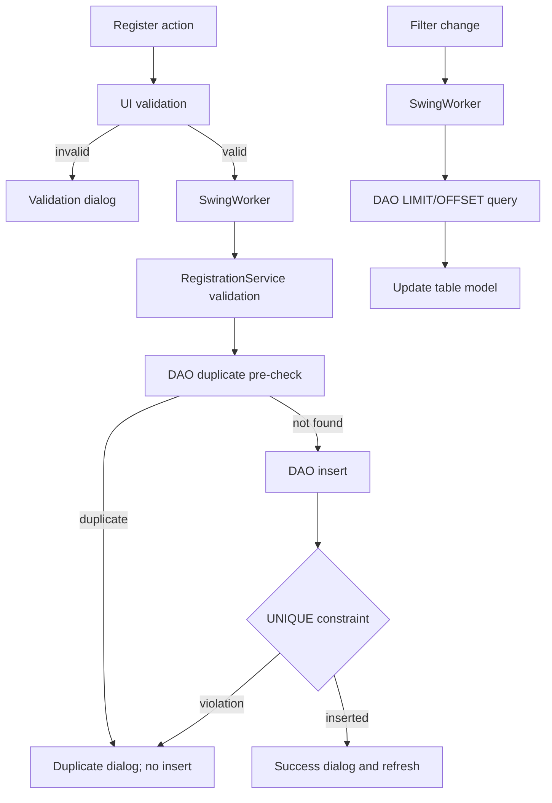
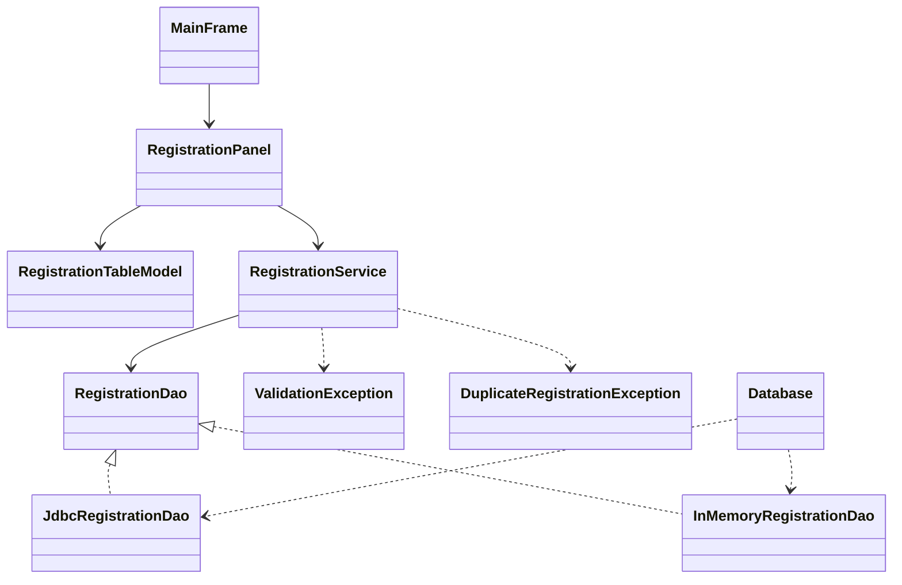

# Task 6 — Event registration app

## Stage 1 — Requirements

- **Users:** students submit their student ID/name and select an event; desk staff register students and review/export the list.
- **Screens:** registration form, filterable registrations table, progress/status area, validation/duplicate/success dialogs, About dialog.
- **Data:** student ID/name; event ID/name; registration ID, student/event IDs, and registration timestamp.
- **Rules:** IDs are positive; name and event are required; one registration per student/event pair; invalid or duplicate input creates no registration row.
- **Testable requirements:** a valid entry is saved; malformed ID/name/event is rejected by UI and service; duplicate shows an error without adding a row; event filter returns only matching rows; export creates valid CSV.

## Stage 2 — Screen sketches and flow

```text
Event Registration
File | View | Help
Student ID [________]  Student name [____________]  Event [v]  [Register]
Filter event [All events v] [Prev] [Next] [Refresh] [Export CSV]
+---------------------------------------------------------------------+
| Registration ID | Student ID | Student | Event | Registered        |
| ...                                                               ...|
+---------------------------------------------------------------------+
Status: Loading / ready / error                 [progress indicator]
```

```text
Validation dialog: "Student ID must be a positive whole number."
Duplicate dialog: "This student is already registered for the event."
Success dialog: "Registered <student> for <event>."
```

Menu: **File** — Export CSV, Exit; **View** — Refresh; **Help** — About.



## Stage 3 — Validation and background work

- UI checks required fields, positive numeric student ID, and selected event before starting work.
- `RegistrationService` repeats validation, checks the event, and pre-checks duplicates.
- MySQL enforces `UNIQUE(student_id, event_id)`; `JdbcRegistrationDao` translates duplicate-key violations into `DuplicateRegistrationException`.
- JDBC and SQL are confined to `JdbcRegistrationDao`; `Database` selects the DAO and reports memory fallback.
- Registration, filtering, CSV data loading, and initial loading run in `SwingWorker`; the progress bar is visible while work is active.

## Stage 4 — Classes and pseudocode



**Register**

```text
1. START
2. INPUT student ID, student name, event
3. IF UI fields are invalid
4.   OUTPUT validation dialog
5.   RETURN
6. ENDIF
7. CALL SwingWorker
8. CALL RegistrationService.register
9. IF service validation fails
10.  OUTPUT validation error
11. ELSE IF duplicate pre-check or UNIQUE constraint fails
12.  OUTPUT duplicate error
13. ELSE
14.  OUTPUT success
15.  CALL Filter current registrations
16. ENDIF
17. END
```

**Filter**

```text
1. START
2. INPUT selected event filter
3. SET page offset to 0
4. CALL SwingWorker
5. CALL RegistrationService.listRegistrations with event, offset, and page size
6. CALL DAO query with LIMIT and OFFSET
7. UPDATE RegistrationTableModel
8. UPDATE Prev and Next controls
9. END
```

## Stage 5 — Implementation and test table

- `schema.sql` defines students, events, registrations, foreign keys, the unique student/event constraint, and sample rows.
- `db.properties.example` documents local configuration; copy it to root `db.properties` and set credentials. That file is ignored by Git.
- `RegistrationDao` has JDBC and in-memory implementations. Without a usable MySQL configuration/connection, startup selects the in-memory DAO and displays the reason.
- File > Export CSV pages through the active event filter and writes escaped CSV in a worker. Initial loads and filter changes show a progress indicator.

| Test | Expected result | Verification |
|---|---|---|
| Normal: `2001`, Riley Chen, Java Conference | Row saved; success shown | In-memory service smoke test passed |
| Invalid: nonnumeric student ID | Validation error; no row | In-memory service smoke test passed |
| Duplicate: same student/event twice | Duplicate error; row count unchanged | In-memory service smoke test passed |
| Filter: Data Science Workshop | Only matching event rows shown | In-memory service smoke test passed |

MySQL integration and interactive dialogs require a local MySQL/JDBC driver and desktop session; the DAO compiles, but database integration was not run in this environment.

## Alternative: load all rows vs paged loading

The benchmark generated 100,000 rows and compared materializing all rows before display with materializing a 100-row first page (the DAO uses SQL `LIMIT`/`OFFSET`, invoked through `SwingWorker`). It used `System.nanoTime()`, one warm-up, and five measured runs; time is the median. Heap delta was sampled after GC and is approximate.

| Strategy | Rows materialized | Time to first page (ns) | Retained heap delta (bytes) |
|---|---:|---:|---:|
| Load all | 100,000 | 3,613,400 | 7,499,184 |
| Paged first page | 100 | 1,500 | 2,296 |

For n total rows and page size p, load-all first display is O(n) time/space; a first-page load is O(p) time/space (subsequent OFFSET costs depend on database/index). Measurements model row materialization and exclude network latency. Raw output: `output.txt`.
