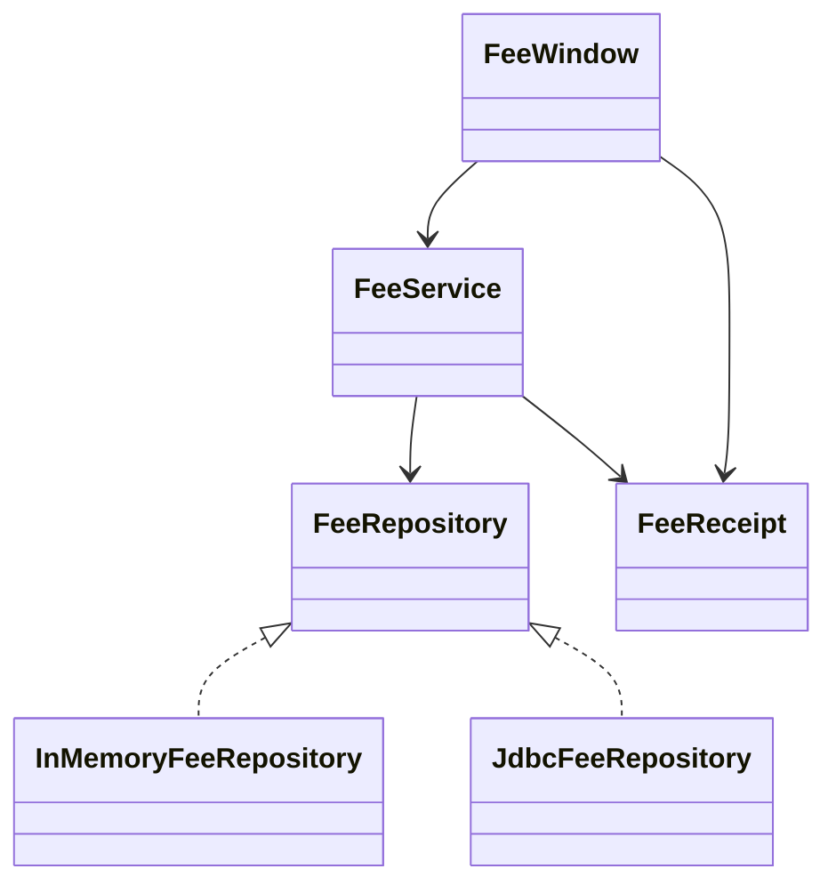
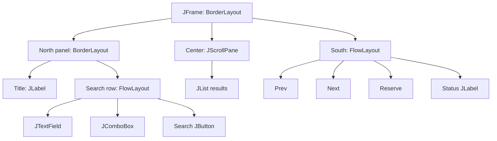
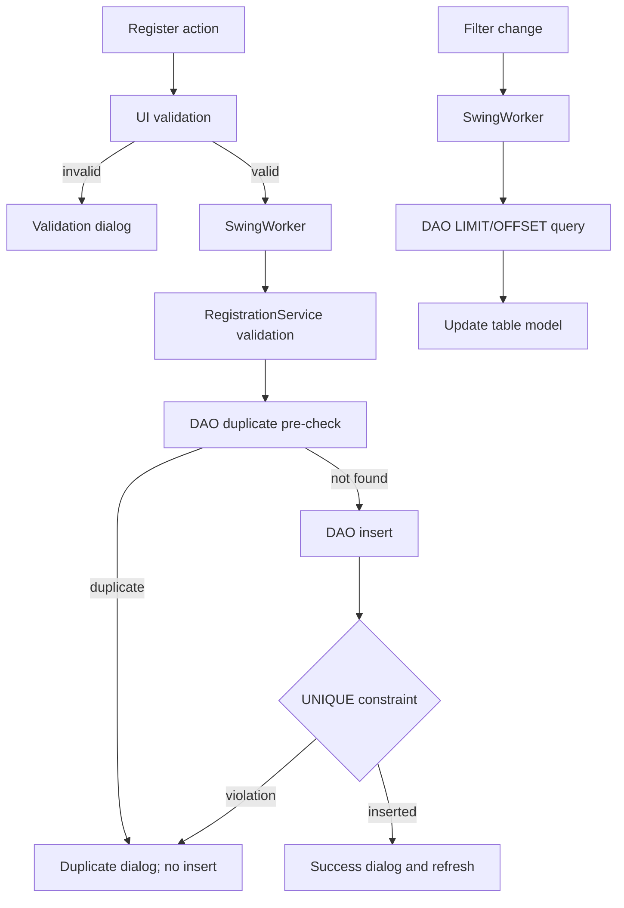
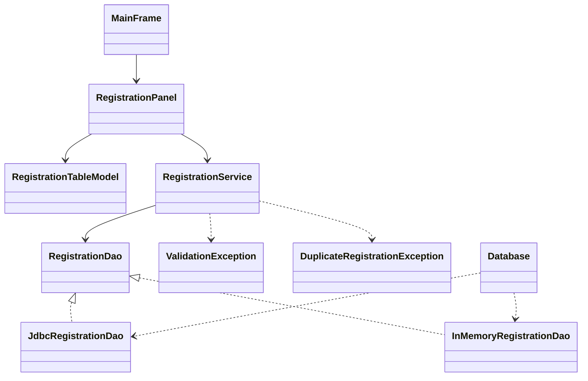

# Task 1 — FeeWindow review

## 1.1 Defects and user-visible effects

| Defect | User-visible effect |
|---|---|
| One listener handles unrelated buttons | A button can trigger the wrong operation when branching is incomplete. |
| Action commands compared with `==` | String identity may not match the command value; the click is ignored or misrouted. |
| No input validation | Blank IDs, malformed amounts, or non-positive payments reach later code and fail unpredictably. |
| JDBC and `sleep(3000)` run on the EDT | The window stops repainting and responding while the operation runs. |
| SQL built by concatenating input | Quotes or crafted input can corrupt the query or alter its meaning. |
| Receipt action falls into the `else` branch | Choosing Receipt performs the fallback action instead of showing the receipt. |
| Exceptions are unhandled | The operation fails without a useful message; the application may print a stack trace or stop. |
| No window-closing handler | Close-time cleanup or confirmation is skipped; resources may remain open. |
| Database connection is never closed | Connections leak and later operations may fail after the pool is exhausted. |

## 1.2 Redesign

- `FeeWindow` owns widgets and event handling; each button has its own listener.
- `FeeService` validates student ID and amount before calling a repository.
- `JdbcFeeRepository` uses `PreparedStatement` parameters and try-with-resources.
- `InMemoryFeeRepository` is used by default, so the UI runs without a database.
- Payment and receipt lookup use `SwingWorker`; errors are surfaced in dialogs.
- A `WindowAdapter` handles the close event.



## 1.3 Defence

Separating the UI, service, and repository keeps database details out of the window and makes the payment rules testable. The service validates before saving, while parameterized SQL prevents user input from becoming SQL syntax. The in-memory repository provides a runnable default without external setup. `SwingWorker` keeps both payment and receipt lookup off the event-dispatch thread, and try-with-resources closes JDBC resources reliably.

## Alternative: one if-else listener vs one listener per button

The chain checks commands sequentially, so dispatch is O(k) in the worst case; direct listener selection is O(1). The benchmark used `System.nanoTime()`, one warm-up and five measured runs per size, randomized action indices with a fixed seed, and the median ns/dispatch. Results are indicative microbenchmark measurements on OpenJDK 25.0.4.1; JIT and hardware affect absolute timings.

| Buttons k | If-else chain (ns/dispatch) | Per-button listener (ns/dispatch) |
|---:|---:|---:|
| 10 | 20.61 | 4.39 |
| 1,000 | 231.05 | 0.65 |
| 10,000 | 1,618.15 | 0.35 |

Dispatch-only space: O(1) extra for the chain and O(k) listener references for per-button registration. Benchmark source: `source/DispatchBenchmark.java`; raw output: `output.txt`.

# Task 2 — Hospital appointment desk

## 2.1 Event table

| Source | Event object | Listener | Action |
|---|---|---|---|
| Department `Choice` | `ItemEvent` | `ItemListener` | Reload doctors, then available slots |
| Doctor `Choice` | `ItemEvent` | `ItemListener` | Reload the doctor's slots |
| Slot `List` | `ItemEvent` | `ItemListener` (optional selection feedback) | Track selected appointment time |
| Book `Button` | `ActionEvent` | `ActionListener` | Validate selections and confirm booking |
| Window | `WindowEvent` | `WindowAdapter` | Dispose the frame on close |

## 2.2 Containment tree

```text
AppointmentDesk (java.awt.Frame, BorderLayout)
├── selectors (java.awt.Panel)
│   ├── java.awt.Label + departmentChoice (java.awt.Choice)
│   └── java.awt.Label + doctorChoice (java.awt.Choice)
├── center (java.awt.Panel, BorderLayout)
│   ├── java.awt.Label (NORTH)
│   └── slotList (java.awt.List, CENTER)
└── footer (java.awt.Panel, BorderLayout)
    ├── bookButton (java.awt.Button, WEST)
    └── status (java.awt.Label, CENTER)
```

## 2.3 Pseudocode

```text
1. START
2. INPUT department selection event
3. CALL refreshDoctors
4. CLEAR doctor choices
5. FOR each doctor in Map[department]
6.   ADD doctor to doctor Choice
7. ENDFOR
8. CALL refreshSlots
9. END
```

```text
1. START
2. INPUT Book action
3. READ selected doctor and slot
4. IF doctor is missing OR slot is missing
5.   OUTPUT selection error
6. ELSE
7.   OUTPUT booking confirmation for doctor and slot
8.   ENDIF
9. END
```

## 2.4 Window event trace and applet comparison

1. Constructor creates controls and registers listeners.
2. `setVisible(true)` requests display.
3. `windowOpened` fires after the frame is shown.
4. `windowActivated` fires when the frame becomes the active window.
5. `windowClosing` fires when the user requests closing.
6. `dispose()` releases the native peer; `windowClosed` fires afterward.

- `init()` initializes an applet once; an application constructs its frame directly.
- `start()` begins/resumes applet activity; a frame is shown with `setVisible(true)`.
- `stop()`/`destroy()` manage applet shutdown; a frame handles `windowClosing` and `dispose()`.

## Alternative: database fetch on every change vs loaded Map

The benchmark simulated a 2 ms fetch delay for each of 8 department changes, using `System.nanoTime()`, one warm-up, and five measured runs (median). The preloaded dataset contains 4 departments and 40 doctors.

| Approach | Median time per 8 changes | Retained doctor records |
|---|---:|---:|
| Fetch on each change | 23.24 ms | 0 cached (temporary query result only) |
| Loaded once into `Map` | 0.022 ms | 40 |

Fetching costs O(L) per change for simulated latency L; lookup from a Map is O(1) average. The cache uses O(D) memory for D doctors; fetching does not retain a cache. Times are machine/JVM dependent. Raw output: `output.txt`.

# Task 3 — Library search screen

## 3.1 Layout by container

| Container | Layout and contents | Why it resizes well |
|---|---|---|
| `JFrame` | `BorderLayout` | The results area receives remaining space. |
| North panel | `BorderLayout`: title north, search row south | Keeps the title and controls grouped at the top. |
| Search row | `FlowLayout`: text field, `JComboBox` (Swing Choice), Search | Controls keep preferred sizes and wrap/reflow with the row. |
| Center | `JScrollPane` containing `JList` results | Scrolls when results exceed the available height; expands with the frame. |
| South | `FlowLayout`: Prev, Next, Reserve, status | Controls stay together at their preferred size. |

## 3.2 Nested-panel diagram



## 3.3 Implementation

`source/LibrarySearch.java` includes title/author/both filtering, Enter-to-search, paged results, reserve feedback, and enabled/disabled Prev/Next controls.

## 3.4 Resize behavior

| Window size | Expected behavior | Screenshot placeholder |
|---|---|---|
| 800 x 600 | Search controls and footer retain preferred sizes; center list uses remaining space. | `library-800x600.png` |
| 1024 x 768 | More result rows are visible; scroll pane remains the expanding region. | `library-1024x768.png` |
| 1440 x 900 | Center region grows; top and bottom controls remain grouped and readable. | `library-1440x900.png` |

## Alternative: GridBagLayout vs null layout

```java
// GridBagLayout: constraints can share extra space and reposition during resize.
panel.setLayout(new GridBagLayout());
GridBagConstraints c = new GridBagConstraints();
c.gridx = column;
c.gridy = row;
c.weightx = 1;
c.fill = GridBagConstraints.HORIZONTAL;
panel.add(component, c);
```

```java
// Null layout: the application must recalculate every bound after a resize.
panel.setLayout(null);
component.setBounds(x, y, width, height);
```

GridBag adapts when appropriately configured, at the cost of more setup and manager work. Null layout performs no automatic repositioning; fixed bounds overlap or leave gaps after resizing unless every child is laid out manually. Timings below are median `System.nanoTime()` results after one warm-up and five runs, on this JVM; GridBag calls `doLayout`, while null layout times an explicit loop applying bounds.

| Components | GridBag relayout (ns) | Null manual bounds (ns) |
|---:|---:|---:|
| 100 | 367,700 | 30,400 |
| 1,000 | 1,856,300 | 68,800 |
| 5,000 | 3,938,300 | 165,300 |

Both require O(n) per relayout and O(n) component/constraint storage. Null's measured loop is faster here but transfers resize responsibility to application code. Raw measurements: `output.txt`.

# Task 4 — DrawPad forensics

## 4.1 Defects

- `mouseclicked` is misspelled; it does not override `mouseClicked`, so click handling never runs.
- The click count and label are never updated, leaving the user without feedback.
- Drawing with `getGraphics()` paints only to the current screen surface and is not retained for later repaints.

## 4.2 Minimize/restore failure

1. Click the canvas; the dot is drawn directly to the current graphics surface.
2. Minimize the window; the operating system may discard that surface.
3. Restore the window or resize it; the component is repainted.
4. `paint()` has no saved point data to redraw, so the dot disappears.

## 4.3 Repaired version

`source/DrawPad.java` stores each click as a `Point`, updates `Clicks: n`, and repaints. Its `Canvas.paint(Graphics)` redraws all stored points with:

```java
for (Point p : points) {
    g.fillOval(p.x - 3, p.y - 3, 6, 6);
}
```

The listener uses `@Override public void mouseClicked(MouseEvent e)`, records the point, updates the label, and requests repaint.

## 4.4 `@Override` demonstration

`OverrideWithoutAnnotation.java` compiles successfully, but `mouseclicked` is only an unrelated overload and is never called for mouse clicks. Adding `@Override` in `OverrideWithAnnotation.java` makes javac report that the method does not override a supertype method. Both compiler outcomes are recorded in `output.txt`.

## Alternative: point list vs off-screen image

The benchmark renders fixed 1000 x 1000 images. It reports median timings from `System.nanoTime()` after one warm-up and five runs. Point storage is estimated at 28 bytes per point (24-byte `Point` plus a 4-byte compressed reference); the image uses 4 bytes per pixel.

| Points n | Point repaint (ns) | Build cached image (ns) | Cached-image repaint (ns) | Point estimate | Image memory |
|---:|---:|---:|---:|---:|---:|
| 1,000 | 2,591,900 | 1,175,000 | 736,500 | 28,000 B | 4,000,000 B |
| 100,000 | 123,928,300 | 120,930,000 | 2,191,400 | 2,800,000 B | 4,000,000 B |
| 1,000,000 | 1,232,034,000 | 1,114,985,700 | 1,615,500 | 28,000,000 B | 4,000,000 B |

Point redraw is O(n) time and O(n) space. A cached image has O(n) one-time build time, then O(1) in n per repaint (copying a fixed W x H image), with O(W x H) pixel space. Image rendering trades fixed pixel memory for much faster repaint at high point counts. Raw compiler and timing output: `output.txt`.

# Task 5 — Currency converter handler styles

## 5.1 Four handler versions

| File | Handler style |
|---|---|
| `source/CurrencyConverterActionListener.java` | Frame implements `ActionListener` |
| `source/CurrencyConverterNamedInner.java` | Named inner `ConvertHandler` |
| `source/CurrencyConverterAnonymous.java` | Anonymous inner listener |
| `source/CurrencyConverterLambda.java` | Lambda listener |

All four handle close events with `WindowAdapter`. They convert USD using fixed demonstration rates for EUR, GBP, and JPY.

## 5.2 Enter conversion and result dialog

Each final version converts on both the Convert button and Enter in the amount field, updates the result label, and displays the result (or invalid-amount message) in a `JOptionPane`.

| Version | Commit | `git diff --stat` |
|---|---|---|
| Button-only baseline | `2c14dac` | 4 files changed, 272 insertions(+) |
| Enter + dialog update | second Task5 commit | 4 files changed, 26 insertions(+), 13 deletions(-) |

The second row is the working-tree `git diff --stat` from the baseline commit, captured before the update commit.

## 5.3 Handler comparison

| Style | Readability | Field access | Reuse | Ease of change |
|---|---|---|---|---|
| Frame implements `ActionListener` | Clear for a tiny frame; event source branching can grow | Direct instance access | Frame itself can be registered on multiple sources | Easy initially, increasingly coupled as actions grow |
| Named inner class | Explicit and easy to find | Direct private access | Good; one object can serve several triggers | Best of these for adding substantial handler logic |
| Anonymous inner class | Handler stays near registration but is verbose | Lexical access | Limited; reusable only if stored | Easy for one small, local handler |
| Lambda | Concise for one operation | Lexical access | Reusable when stored in a variable | Easy for simple behavior; extract a class as logic grows |

For large applications, prefer a named `Action` or named handler: it can carry command name, enabled state, icon, shortcut, and behavior in one reusable unit.

## Alternative: method reference vs shared Swing `Action`

```java
button.addActionListener(this::convert);
amount.addActionListener(this::convert);
```

```java
Action convertAction = new AbstractAction("Convert") {
    @Override public void actionPerformed(ActionEvent e) { convert(); }
};
button.setAction(convertAction);
menuItem.setAction(convertAction);
getRootPane().getInputMap(JComponent.WHEN_IN_FOCUSED_WINDOW)
        .put(KeyStroke.getKeyStroke("ctrl ENTER"), "convert");
getRootPane().getActionMap().put("convert", convertAction);
```

The setup benchmark uses `System.nanoTime()`, one warm-up and five runs, and reports median nanoseconds for 1, 3, and 10 trigger controls. It includes control creation and a keyboard binding.

| Triggers | Method-reference setup (ns) | Shared-Action setup (ns) | Handler objects |
|---:|---:|---:|---|
| 1 | 373,800 | 435,000 | 1 listener vs 1 Action |
| 3 | 447,700 | 460,000 | 3 listeners vs 1 Action |
| 10 | 941,700 | 966,800 | 10 listeners vs 1 Action |

Both require O(k) setup time and O(k) trigger bindings/components. Method-reference handlers use O(k) listener objects; a shared Action uses O(1) action objects plus O(k) bindings. Small timing differences are JVM/UI-component overhead, not a meaningful speed claim. Raw output: `output.txt`.

# Task 6 — Event registration app

## Stage 1 — Requirements

- **Users:** students submit their student ID/name and select an event; desk staff register students and review/export the list.
- **Screens:** registration form, filterable registrations table, progress/status area, validation/duplicate/success dialogs, About dialog.
- **Data:** student ID/name; event ID/name; registration ID, student/event IDs, and registration timestamp.
- **Rules:** IDs are positive; name and event are required; one registration per student/event pair; invalid or duplicate input creates no registration row.
- **Testable requirements:** a valid entry is saved; malformed ID/name/event is rejected by UI and service; duplicate shows an error without adding a row; event filter returns only matching rows; export creates valid CSV.

## Stage 2 — Screen sketches and flow

```text
Event Registration
File | View | Help
Student ID [________]  Student name [____________]  Event [v]  [Register]
Filter event [All events v] [Prev] [Next] [Refresh] [Export CSV]
+---------------------------------------------------------------------+
| Registration ID | Student ID | Student | Event | Registered        |
| ...                                                               ...|
+---------------------------------------------------------------------+
Status: Loading / ready / error                 [progress indicator]
```

```text
Validation dialog: "Student ID must be a positive whole number."
Duplicate dialog: "This student is already registered for the event."
Success dialog: "Registered <student> for <event>."
```

Menu: **File** — Export CSV, Exit; **View** — Refresh; **Help** — About.



## Stage 3 — Validation and background work

- UI checks required fields, positive numeric student ID, and selected event before starting work.
- `RegistrationService` repeats validation, checks the event, and pre-checks duplicates.
- MySQL enforces `UNIQUE(student_id, event_id)`; `JdbcRegistrationDao` translates duplicate-key violations into `DuplicateRegistrationException`.
- JDBC and SQL are confined to `JdbcRegistrationDao`; `Database` selects the DAO and reports memory fallback.
- Registration, filtering, CSV data loading, and initial loading run in `SwingWorker`; the progress bar is visible while work is active.

## Stage 4 — Classes and pseudocode



**Register**

```text
1. START
2. INPUT student ID, student name, event
3. IF UI fields are invalid
4.   OUTPUT validation dialog
5.   RETURN
6. ENDIF
7. CALL SwingWorker
8. CALL RegistrationService.register
9. IF service validation fails
10.  OUTPUT validation error
11. ELSE IF duplicate pre-check or UNIQUE constraint fails
12.  OUTPUT duplicate error
13. ELSE
14.  OUTPUT success
15.  CALL Filter current registrations
16. ENDIF
17. END
```

**Filter**

```text
1. START
2. INPUT selected event filter
3. SET page offset to 0
4. CALL SwingWorker
5. CALL RegistrationService.listRegistrations with event, offset, and page size
6. CALL DAO query with LIMIT and OFFSET
7. UPDATE RegistrationTableModel
8. UPDATE Prev and Next controls
9. END
```

## Stage 5 — Implementation and test table

- `schema.sql` defines students, events, registrations, foreign keys, the unique student/event constraint, and sample rows.
- `db.properties.example` documents local configuration; copy it to root `db.properties` and set credentials. That file is ignored by Git.
- `RegistrationDao` has JDBC and in-memory implementations. Without a usable MySQL configuration/connection, startup selects the in-memory DAO and displays the reason.
- File > Export CSV pages through the active event filter and writes escaped CSV in a worker. Initial loads and filter changes show a progress indicator.

| Test | Expected result | Verification |
|---|---|---|
| Normal: `2001`, Riley Chen, Java Conference | Row saved; success shown | In-memory service smoke test passed |
| Invalid: nonnumeric student ID | Validation error; no row | In-memory service smoke test passed |
| Duplicate: same student/event twice | Duplicate error; row count unchanged | In-memory service smoke test passed |
| Filter: Data Science Workshop | Only matching event rows shown | In-memory service smoke test passed |

MySQL integration and interactive dialogs require a local MySQL/JDBC driver and desktop session; the DAO compiles, but database integration was not run in this environment.

## Alternative: load all rows vs paged loading

The benchmark generated 100,000 rows and compared materializing all rows before display with materializing a 100-row first page (the DAO uses SQL `LIMIT`/`OFFSET`, invoked through `SwingWorker`). It used `System.nanoTime()`, one warm-up, and five measured runs; time is the median. Heap delta was sampled after GC and is approximate.

| Strategy | Rows materialized | Time to first page (ns) | Retained heap delta (bytes) |
|---|---:|---:|---:|
| Load all | 100,000 | 3,613,400 | 7,499,184 |
| Paged first page | 100 | 1,500 | 2,296 |

For n total rows and page size p, load-all first display is O(n) time/space; a first-page load is O(p) time/space (subsequent OFFSET costs depend on database/index). Measurements model row materialization and exclude network latency. Raw output: `output.txt`.

